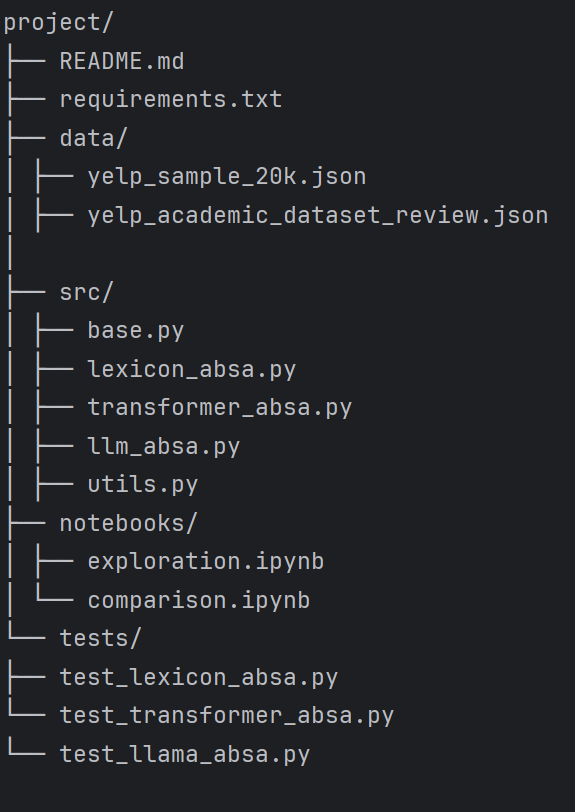

# LLM Sentiment Project 2025  (Group 17)
**Aspect-Based Sentiment Analysis (ABSA) System**  
*Course: Applied Computer Science Data & AI 6*  
*Authors: Lesly Tianga, Megane Fomo*
---

## Project Overview

This project implements a comprehensive **Aspect-Based Sentiment Analysis (ABSA)** system that identifies aspects (features) mentioned in text and determines the sentiment expressed toward each aspect.

Unlike traditional sentiment analysis, which assigns a single polarity to an entire review, **ABSA** breaks the text into *aspect–sentiment pairs* for more fine-grained insights.

**Example:**

> "The pizza was delicious but the service was terrible."

| Aspect | Sentiment | Confidence |
|---------|------------|-------------|
| pizza   | positive   | 0.92        |
| service | negative   | 0.87        |

The system includes **three independent implementations** of ABSA, each using a different approach and unified through a shared API:

| Implementation | Description | Core Technology |
|----------------|--------------|-----------------|
| **LexiconABSA** | Rule-based ABSA using linguistic rules and sentiment lexicons | spaCy + VADER |
| **TransformerABSA** | Pre-trained ABSA model using Transformers | DeBERTa-v3 (Hugging Face) |
| **LLMABSA** | Aspect–sentiment extraction using local large language models | Ollama (Llama/Mistral) |

---

## Project Structure

---

## Setup Instructions

### 1. Download and Unzip Project

```
Download the zip file and unzip in your favourite location
cd llm-sentiment-project
```
### 2. Create a virtual environment
```
python -m venv venv
source venv/bin/activate    # macOS / Linux
venv\Scripts\activate       # Windows
```

### 3. Install dependencies
```
pip install -r requirements.txt
```

### 4. Download NLP models
```
python -m spacy download en_core_web_sm
```
Optional(for TransformerABSA):
```
pip install sentencepiece protobuf
```

## Dependencies
| Library                           | Purpose                                      |
| --------------------------------- | -------------------------------------------- |
| **spaCy**                         | Linguistic preprocessing, dependency parsing |
| **vaderSentiment**                | Lexicon-based sentiment scoring              |
| **transformers**                  | Pre-trained ABSA model (DeBERTa-v3)          |
| **torch**                         | Model inference for Transformers             |
| **ollama**                        | Local LLM-based ABSA                         |
| **pandas / seaborn / matplotlib** | Exploratory data analysis and visualization  |
| **pytest**                        | Unit testing framework                       |

## Usage Examples
### 1. LexiconABSA (Rule-Based Approach)
```bash
model = LexiconABSA(LexiconABSAConfig())
text = "The food was great but the service was slow."
results = model.analyze(text)
for r in results:
    print(f"   ➜ {r.aspect:<20} | {r.sentiment:<10} | conf={r.confidence:.2f}")
```
Output:
```
➜ food      | positive   | conf=0.46
➜ service   | negative   | conf=0.38
```
### 2. TransformerABSA (Pre-trained Model Approach)
```bash
model = TransformerABSA(TransformerABSAConfig())
text = "The mushroom risotto was perfection, but the service was slow. The atmosphere was cozy"
results = model.analyze(text)
for r in results:
    print(f"   ➜ {r.aspect:<20} | {r.sentiment:<10} | conf={r.confidence:.2f}")
```
Output:
```
   ➜ mushroom risotto     | positive   | conf=0.99
   ➜ service              | negative   | conf=0.99
   ➜ atmosphere           | positive   | conf=1.00
```

### 3. LLMABSA (Large Language Model Approach)
Make sure Ollama is running
``` 
ollama run llama3
```
```bash
model = LLMABSA(model_name="llama3", max_aspects=8)
text = "The coffee was bitter and cold. However, the baristas were very friendly."
results = model.analyze(text)
for r in results:
    print(f"   ➜ {r.aspect:<20} | {r.sentiment:<10} | conf={r.confidence:.2f}")
```
Output:
```
➜ coffee        | negative   | conf=0.90
➜ baristas      | positive   | conf=0.85
```
## Running Tests
Each implementation has its own test file under /tests:
- test_lexicon_absa.py 
- test_transformer_absa.py 
- test_llama_absa.py

Run all tests
``` 
pytest -v
```
Run one test file
``` 
pytest -v tests\test_lexicon_absa.py 
```


## Unified API Documentation
All three implementations inherit from the same base interface defined in src/base.py.

### Base Class

```bas
class AspectSentiment:
    aspect: str # The aspect/feature mentioned
    sentiment: str  # 'positive'|'negative'|'neutral'
    confidence: float  # Confidence score (0.0 to 1.0)
    text_span: Tuple[int,int] = None # Optional: (start, end) position in original text

class ABSAAnalyzer:
    """Base class/interface for all ABSA implementations"""
    def analyze(self, text: str) -> List[AspectSentiment]:
        """
        Analyze text and extract aspect-sentiment pairs
        Args:
        text: Input text to analyze
        Returns:
        List of AspectSentiment objects
        """
    raise NotImplementedError
```

## Design Decisions & Rationale
### **LexiconABSA (Rule-Based)**

- **Use of Noun Chunks:**  
  We used spaCy’s `noun_chunks` as aspect candidates because they capture complete, meaningful entities (e.g., “mushroom risotto”, “customer service”) rather than isolated words.

- **Removal of Pronouns:**  
  Pronouns like *it*, *they*, and *this* are context-dependent and not meaningful aspects on their own. Filtering them prevents false positives.

- **Sentence-Level Analysis:**  
  Sentiment expressions are typically contained within a sentence. Processing each sentence separately avoids sentiment spillover between clauses.

- **Custom Sentiment Lexicon & Phrase Overrides:**  
  To improve domain coverage, custom entries (e.g., “cozy”, “divine”, “worth every penny”) and idiomatic overrides (e.g., “not bad”, “never disappoints”) were added. This ensures polarity alignment in common restaurant-review contexts.

- **Aspect–Opinion Linking Patterns:**  
  Implemented in `_find_aspect_opinions_in_sent()`, this function uses dependency relations like:
  - `amod` / `acomp` → adjectival modifiers (“delicious pizza”)  
  - `nsubj` + copular verbs → (“service was slow”)  
  - `verb-object` pairs → (“staff disappointed”)  
  - Coordinations and relative clauses → (“cake, which was divine”)  
  These patterns robustly map aspects to their sentiment expressions in varied syntax.

---

### **TransformerABSA (Hybrid Pretrained Models)**

- **Hybridization Decision:**  
  During model exploration:
  - `yangheng/deberta-v3-base-end2end-absa` was strong at **aspect extraction** but weaker in sentiment labeling.  
  - `yangheng/deberta-v3-base-absa-v1.1` excelled in **sentiment classification** but did not extract aspects automatically.  
  The solution was to **hybridize both models** — one to detect aspects, the other to classify their sentiment — achieving higher precision and recall together.

- **Exception-Safe Loading:**  
  Implemented try–except logic for model initialization to handle missing or incompatible Hugging Face models gracefully.

- **Confidence-Based Merging:**  
  If a sentiment prediction has low confidence but aspect extraction is strong, the model uses aspect confidence as a fallback for stability.

---

### **LLMABSA (Ollama – Prompt-Engineered LLM)**

- **Prompt Engineering:**  
  A structured system prompt was designed to enforce JSON output, guide the model to identify noun-based aspects, and classify each as *positive*, *negative*, or *neutral*.  
  Few-shot examples were added to stabilize responses and reduce ambiguity.

- **Strict Output Schema:**  
  The model is instructed to return responses as:
  ```json
  [
    {"aspect": "service", "sentiment": "negative", "confidence": 0.85}
  ]


## References
- **spaCy Documentation:** [https://spacy.io/](https://spacy.io/)
- **VADER Sentiment:** [Python Sentiment Analysis using VADER](https://www.geeksforgeeks.org/python/python-sentiment-analysis-using-vader/)
- **Hugging Face Transformers:**
  - [LLM Course (Chapter 0)](https://huggingface.co/learn/llm-course/chapter0/1)
  - [DeBERTa-v3-large-ABSA-v1.1](https://huggingface.co/yangheng/deberta-v3-large-absa-v1.1)
  - [DeBERTa-v3-base-end2end-ABSA](https://huggingface.co/yangheng/deberta-v3-base-end2end-absa)
- **Ollama Local LLMs:** [Ollama API Docs](https://github.com/ollama/ollama/blob/main/docs/api.md)
- **Other resources:**
  - [What is Sentiment Analysis?](https://www.geeksforgeeks.org/machine-learning/what-is-sentiment-analysis/)
  - [Stanford Sentiment Treebank Paper (Socher et al., 2014)](https://nlp.stanford.edu/pubs/USD_LREC14_paper_camera_ready.pdf)
  - [Universal Dependencies Project](https://universaldependencies.org/u/dep/)
- **Testing:** [Pytest Documentation](https://docs.pytest.org/en/stable/)
- **Code Assistance:** ChatGPT

## Responsible Use of AI Tools

This project was developed with the support of AI-assisted tools (e.g., ChatGPT) for:
- Code generation and debugging support  
- Documentation structuring and explanation drafting  

All AI-generated content was **reviewed, verified, and edited** by the authors.  
All analysis, model design, interpretation, and final conclusions were **entirely performed by the project authors**.  
No section of this report or notebook was submitted without human review and validation.

