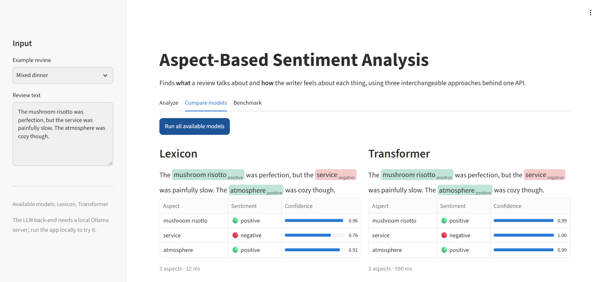
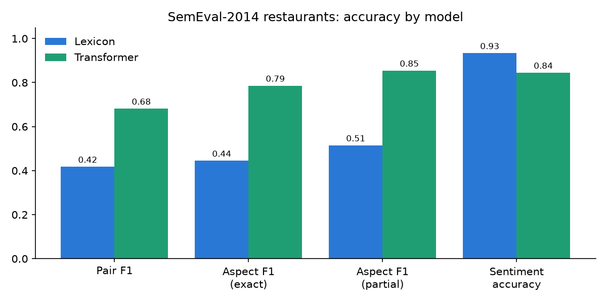
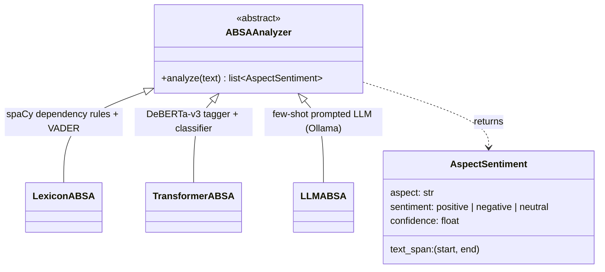

# Aspect-Based Sentiment Analysis: rules vs. Transformers vs. LLMs

[](https://github.com/meganekarol/aspect-based-sentiment-analysis/actions/workflows/ci.yml)

[](LICENSE)

Finds **what** a review talks about and **how** the writer feels about each thing.
It does this with three interchangeable approaches behind one Python API, and
benchmarks them against the standard SemEval-2014 dataset.

> "The mushroom risotto was perfection, but the service was painfully slow."
>
> → **mushroom risotto**: positive · **service**: negative

Plain sentiment analysis gives this review one score ("mixed"). Aspect-based
sentiment analysis (ABSA) gives a score for each aspect, which is what a
restaurant owner, product team or analyst actually needs.



## Results

Evaluated on the **SemEval-2014 Task 4 restaurant test set**: 800 sentences and
1,120 gold aspect terms. See [`scripts/benchmark.py`](scripts/benchmark.py) and the full
[results](results/benchmark.md).

| Model | Pair F1 (strict) | Aspect F1 | Sentiment accuracy* | Latency (CPU) |
|---|---|---|---|---|
| Lexicon (spaCy + VADER) | 0.417 | 0.445 | 0.933 | **9 ms** |
| Transformer (DeBERTa-v3) | **0.681** | **0.785** | 0.844 | 386 ms |
| LLM (Llama 3, Ollama) | *run locally, see below* | | | |

<sub>*Sentiment accuracy is computed only over the aspects each model found, so it
is not comparable across models with very different recall. Pair F1 is the
headline metric: an aspect counts only if its text matches exactly and its
polarity is correct. Latency is the mean per sentence on a desktop CPU, with no GPU.</sub>



**What the numbers say**

- The **Transformer** is the most accurate overall. It finds 81% of the gold
  aspects with the exact text.
- The **lexicon** model is **~40x faster** and gets polarity right 93% of the time
  *when* it finds an aspect. But it only reports aspects linked to an explicit
  opinion word, so it misses most of them (recall 0.31) and never predicts
  neutral.
- Neither model handles sarcasm. Many transformer "false positives" are
  *place*/*restaurant*, which SemEval deliberately does not annotate.

Benchmarking also turned up several bugs that the unit tests had missed: negation
handling, aspect boundaries and span offsets. Fixing them raised the lexicon
model's pair F1 from **0.256 to 0.417**. See
[design.md → fixes found by benchmarking](docs/design.md#fixes-found-by-benchmarking)
and the [error analysis](docs/error_analysis.md).

## Three approaches, one API



| | Lexicon | Transformer | LLM |
|---|---|---|---|
| **How** | spaCy dependency parse links aspects (noun phrases) to opinion words; VADER + a domain lexicon scores them, handling negation and intensifiers | `deberta-v3-base-end2end-absa` tags aspect spans; `deberta-v3-base-absa-v1.1` classifies the sentiment of each aspect | Few-shot prompt to a local LLM (Llama 3 via Ollama) returning strict JSON; output validated, retried on failure |
| **Strengths** | ~10 ms on CPU, no GPU, every prediction traceable to a rule | Best accuracy; handles implicit and multi-word aspects | No training data; easy to adapt by changing the prompt |
| **Weaknesses** | Misses aspects without an explicit opinion word; never predicts neutral | ~0.4 s/sentence on CPU, ~1.5 GB of model weights | Slowest; output varies between runs; needs an LLM server |

Implementation notes and design rationale: [docs/design.md](docs/design.md).

## Quickstart

```bash
git clone https://github.com/meganekarol/aspect-based-sentiment-analysis.git
cd aspect-based-sentiment-analysis
python -m venv .venv && source .venv/bin/activate      # Windows: .venv\Scripts\activate

pip install -e .                          # lexicon model only (lightweight)
pip install -e ".[transformer,llm,demo]"  # everything
python -m spacy download en_core_web_sm
```

**Python**

```python
from absa import get_analyzer

model = get_analyzer("lexicon")           # or "transformer", or "llm"
for r in model.analyze("The food was not bad, but the waiter was rude."):
    print(r.aspect, r.sentiment, r.confidence)
# food positive 0.84
# waiter negative 0.94
```

**Command line**

```bash
absa analyze "The pizza was great but service was slow." --model lexicon
absa analyze "Loved the outdoor seating!" --model transformer --json
```

**Demo app**

```bash
streamlit run app/streamlit_app.py
```

The app highlights each aspect in the text, compares models side by side and
shows the benchmark. For the LLM back-end, install [Ollama](https://ollama.com),
run `ollama pull llama3`, and start the app with
`OLLAMA_HOST=http://localhost:11434`.

## Reproduce the benchmark

```bash
pip install -e ".[transformer,llm,eval]"
python scripts/benchmark.py --models lexicon transformer   # downloads the SemEval gold file
python scripts/benchmark.py --models llm --llm-model llama3 # needs Ollama running
```

This writes per-model metrics to `results/`, raw predictions to
`results/predictions/` and charts to `docs/img/`. Pair F1 counts an aspect only
if its text matches the gold term exactly *and* its polarity is right.
`conflict` labels are excluded, as is standard. The scorer has its own unit tests
([`tests/test_evaluate.py`](tests/test_evaluate.py)).

## Tests

```bash
pip install -e ".[dev]"
pytest -m "not slow and not llm"   # fast suite, runs in CI
pytest -m slow                     # Transformer tests (downloads models)
pytest -m llm                      # needs Ollama
```

Known limitations are kept as `xfail` tests rather than deleted, so they stay
documented and any fix shows up.

## Project structure

```
src/absa/
  base.py              ABSAAnalyzer interface + AspectSentiment dataclass
  lexicon_absa.py      rule-based analyzer (spaCy + VADER)
  transformer_absa.py  DeBERTa-v3 hybrid analyzer
  llm_absa.py          Ollama LLM analyzer
  utils.py             aspect extraction + scoring helpers
  datasets.py          SemEval-2014 loader
  evaluate.py          P/R/F1, pair F1, sentiment metrics
  cli.py               `absa` command
app/streamlit_app.py   interactive demo
scripts/benchmark.py   benchmark runner -> results/, docs/img/
notebooks/             exploratory analysis (Yelp) + qualitative model comparison
docs/                  design notes, error analysis, original project report
tests/                 pytest suite (fast / slow / llm markers)
```

## Data

- **Benchmark:** SemEval-2014 Task 4 (Pontiki et al., 2014), downloaded on demand.
  It is not redistributed here.
- **Exploration:** the notebooks use a random sample of the
  [Yelp Open Dataset](https://www.yelp.com/dataset). Yelp's terms don't allow
  redistribution, so download it yourself and build the sample with
  `python scripts/prepare_yelp.py path/to/yelp_academic_dataset_review.json`.
  This writes `data/yelp/yelp_sample.json` from a fixed seed.
- **Demo examples** (`data/examples.jsonl`) were written for this project.

## Limitations and future work

- Fine-tune the aspect tagger on in-domain (Yelp) data, and distil it to cut
  CPU latency.
- Group aspect terms into categories (food, service, ambience, price) for
  review-level dashboards.
- Add a hosted-LLM back-end so the LLM option works without a local Ollama server.
- Handle sarcasm and implicit aspects ("we waited 40 minutes" → *service*
  negative). All three approaches still struggle with these.

## Authors and credits

Built by **Megane Fomo** and **Lesly Tianga**. It started as a course project in
Applied Computer Science, Data & AI. The original project report is at
[`docs/report.pdf`](docs/report.pdf).

**My contributions (Megane Fomo)**
- Designed and implemented **`LexiconABSA`**: the dependency-pattern rules that
  link aspects to opinion words, the domain lexicon, and the negation,
  intensifier and diminisher handling.
- Designed and implemented **`TransformerABSA`**: combining two DeBERTa-v3 models
  (one for aspect tagging, one for aspect-conditioned sentiment).
- Built the **model comparison notebook** (`notebooks/comparison.ipynb`).
- Turned the course project into this portfolio version: packaging and CLI, CI,
  the SemEval-2014 benchmark and evaluation code, the bug fixes it surfaced
  (pair F1 0.256 → 0.417 for the lexicon model, 0.647 → 0.681 for the
  Transformer), the Streamlit demo and the error analysis.

**AI assistance:** parts of the code and documentation were drafted with AI
assistants (ChatGPT, Perplexity, Claude). The authors reviewed, tested and
validated all of it. The design, evaluation and conclusions are the authors'
own.

**Models and libraries:** [spaCy](https://spacy.io),
[VADER](https://github.com/cjhutto/vaderSentiment),
[yangheng/deberta-v3-base-end2end-absa](https://huggingface.co/yangheng/deberta-v3-base-end2end-absa),
[yangheng/deberta-v3-base-absa-v1.1](https://huggingface.co/yangheng/deberta-v3-base-absa-v1.1),
[Ollama](https://ollama.com).

Licensed under the [MIT License](LICENSE).
